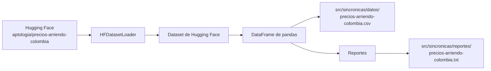
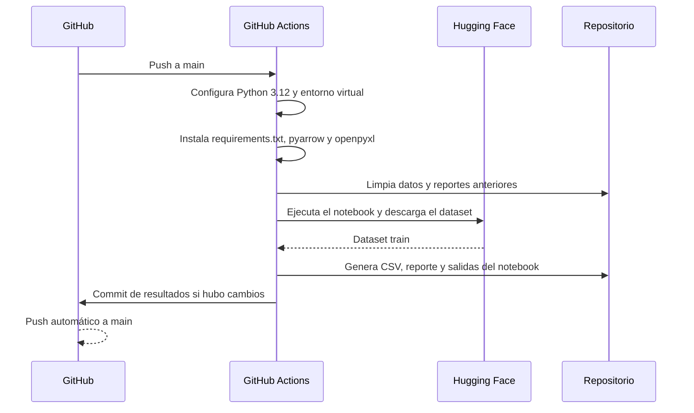

# PI3 - Carga y reporte de datos de arriendos en Colombia

Mini proyecto de procesamiento de datos desarrollado en Python. El proyecto
descarga un dataset de precios de arriendo desde Hugging Face, lo transforma en
un `pandas.DataFrame`, lo persiste en formato CSV y genera un reporte
descriptivo con información de calidad y estadísticas numéricas.

## Objetivos

- Encapsular la descarga de datasets de Hugging Face en una clase reutilizable.
- Convertir los datos descargados a un `DataFrame` de pandas.
- Permitir limitar el número de filas y configurar caché o autenticación.
- Exportar los datos a CSV, JSON, Parquet o Excel.
- Generar reportes legibles con dimensiones, duplicados, tipos, nulos y
  estadísticas descriptivas.
- Automatizar la ejecución del notebook mediante GitHub Actions.

## Resultado actual

El notebook trabaja con el dataset
[`aptologia/precios-arriendo-colombia`](https://huggingface.co/datasets/aptologia/precios-arriendo-colombia),
en la partición `train`. La ejecución registrada produjo:

- **1.460 filas**
- **10 columnas**
- **0 filas duplicadas**
- **0 valores nulos**
- Archivo de datos: `src/sincronicas/datos/precios-arriendo-colombia.csv`
- Reporte: `src/sincronicas/reportes/precios-arriendo-colombia.txt`

Los valores de precio (`p25`, `mediana` y `p75`) corresponden al dataset de
origen y se conservan sin transformaciones adicionales.

## Arquitectura y flujo



El flujo implementado es:

1. El notebook localiza la raíz del repositorio y agrega `src` al `sys.path`.
2. Se instancia `HFDatasetLoader` con el nombre del dataset, la partición y la
   ruta de salida.
3. `load()` llama a `datasets.load_dataset()`.
4. El dataset se convierte a pandas mediante `to_pandas()`.
5. Si se configuró `filename`, el `DataFrame` se guarda en el formato indicado
   o inferido a partir de la extensión.
6. `Reportes.generar_reporte()` calcula el resumen del `DataFrame`.
7. `Reportes.guardar_reporte()` escribe el resumen en un archivo de texto.

## Estructura del repositorio

```text
.
├── .github/
│   └── workflows/
│       └── ejecutar-semana-1.yml       # Automatización en GitHub Actions
├── requirements.txt                    # Dependencias de Python
├── src/
│   ├── clases_po/
│   │   ├── __init__.py                 # API pública del paquete
│   │   ├── hf_loader.py                # Carga y exportación de datasets
│   │   └── reportes.py                 # Generación de reportes
│   └── sincronicas/
│       ├── Semana_1SINC.ipynb          # Flujo ejecutable/documentado
│       ├── datos/                      # Datos exportados
│       └── reportes/                   # Reportes generados
└── README.md
```

## Componentes principales

### `HFDatasetLoader`

Se encuentra en `src/clases_po/hf_loader.py`. Sus responsabilidades son:

- Descargar una partición de un dataset de Hugging Face.
- Aceptar `config`, `token` y `cache_dir` para datasets configurables,
  privados o con caché personalizada.
- Limitar filas mediante `max_rows`.
- Mantener el último resultado en `loader.df`.
- Guardar el resultado en `csv`, `json`, `parquet` o `xlsx`.
- Validar valores inválidos de `max_rows` y formatos de archivo.

### `Reportes`

Se encuentra en `src/clases_po/reportes.py`. Ofrece:

- `generar_reporte(df)`: devuelve el reporte como `str`.
- `imprimir_reporte(df)`: imprime el reporte en consola.
- `guardar_reporte(df, ruta)`: crea las carpetas necesarias y guarda el
  reporte en UTF-8.

El reporte incluye:

- Número de filas y columnas.
- Cantidad de registros duplicados.
- Tipo de cada columna.
- Valores nulos por columna.
- `describe()` de las columnas numéricas, redondeado a tres decimales.

## Esquema de datos

El CSV generado contiene las siguientes columnas:

| Columna | Descripción |
| --- | --- |
| `fecha` | Fecha de referencia del registro. |
| `ciudad_id` | Identificador textual de la ciudad. |
| `ciudad` | Nombre de la ciudad. |
| `barrio` | Barrio o zona de la ciudad. |
| `avisos` | Cantidad de avisos considerados. |
| `p25` | Percentil 25 del precio de arriendo. |
| `mediana` | Precio mediano de arriendo. |
| `p75` | Percentil 75 del precio de arriendo. |
| `con_parqueadero` | Cantidad de avisos con parqueadero. |
| `con_telefono` | Cantidad de avisos con teléfono. |

Los campos de precios y conteos son numéricos. `fecha`, `ciudad_id`, `ciudad` y
`barrio` se cargan como columnas de texto en el flujo actual.

## Requisitos

- Python 3.12 o una versión compatible con las dependencias del proyecto.
- `pip`.
- Acceso a internet para descargar el dataset de Hugging Face en la primera
  ejecución.

La automatización oficial usa Python 3.12, crea un entorno virtual e instala
las dependencias desde `requirements.txt`.

## Instalación local

Desde la raíz del repositorio:

```bash
python3.12 -m venv .venv
source .venv/bin/activate
python -m pip install --upgrade pip
python -m pip install -r requirements.txt
```

En Windows PowerShell:

```powershell
py -3.12 -m venv .venv
.venv\Scripts\Activate.ps1
python -m pip install --upgrade pip
python -m pip install -r requirements.txt
```

Para exportar específicamente a Parquet o Excel también se necesitan los
motores correspondientes:

```bash
python -m pip install pyarrow openpyxl
```

## Ejecución del notebook

El flujo completo se puede ejecutar desde la raíz con:

```bash
source .venv/bin/activate
cd src/sincronicas
jupyter nbconvert \
  --to notebook \
  --execute \
  --inplace \
  --ExecutePreprocessor.timeout=1800 \
  Semana_1SINC.ipynb
```

También se puede abrir el notebook en Jupyter:

```bash
jupyter notebook src/sincronicas/Semana_1SINC.ipynb
```

Las rutas relativas del notebook apuntan al directorio de trabajo
`src/sincronicas`, por lo que el comando anterior conserva la estructura
esperada de salidas. Al finalizar, se actualizan:

```text
src/sincronicas/datos/precios-arriendo-colombia.csv
src/sincronicas/reportes/precios-arriendo-colombia.txt
```

## Uso de las clases

Para reutilizar el cargador desde otro script:

```python
import sys
from pathlib import Path

sys.path.insert(0, str(Path("src").resolve()))

from clases_po import HFDatasetLoader, Reportes

loader = HFDatasetLoader(
    dataset_name="aptologia/precios-arriendo-colombia",
    split="train",
    max_rows=100,
    filename="salidas/arriendos.csv",
)

df = loader.load()
print(loader.info())

reportes = Reportes()
reportes.imprimir_reporte(df)
reportes.guardar_reporte(df, "salidas/arriendos.txt")
```

### Formatos de exportación

El tipo de archivo se puede indicar explícitamente:

```python
loader = HFDatasetLoader(
    dataset_name="aptologia/precios-arriendo-colombia",
    filename="salidas/arriendos.parquet",
    file_type="parquet",
)
```

Si no se indica `file_type`, se infiere desde la extensión de `filename`.
También se acepta `excel` como alias de `xlsx`.

### Dataset privado o caché personalizada

No es necesario un token para el dataset público usado actualmente. Para un
dataset privado, se puede entregar el token directamente o usar el mecanismo
de autenticación recomendado por Hugging Face:

```python
loader = HFDatasetLoader(
    dataset_name="organizacion/dataset-privado",
    token="hf_...",
    cache_dir=".cache/huggingface",
)
```

No se deben incluir tokens en el código versionado. Es preferible usar una
variable de entorno y pasar su valor al constructor.

## Automatización con GitHub Actions

El workflow `.github/workflows/ejecutar-semana-1.yml` se ejecuta en cada `push`
a `main` y realiza el siguiente proceso:



El workflow utiliza caché de pip y fija un timeout de 30 minutos para la
ejecución del notebook. Si no se producen cambios, no crea un commit vacío.

## Solución de problemas

### No se puede descargar el dataset

Verifica la conexión a internet y que el identificador del dataset y la
partición sean correctos. Para datasets privados, configura un token válido.

### Error al guardar Parquet o Excel

Instala los motores opcionales:

```bash
python -m pip install pyarrow openpyxl
```

### `ModuleNotFoundError: clases_po`

Ejecuta el notebook desde el repositorio o agrega `src` al `PYTHONPATH`:

```bash
export PYTHONPATH="$PWD/src:$PYTHONPATH"
```

El notebook ya realiza esta configuración automáticamente al buscar la raíz
del repositorio.

### `RuntimeError: Llama a load() primero`

`Reportes` necesita un `DataFrame` válido. Primero ejecuta
`df = loader.load()` y luego genera o guarda el reporte.

## Alcance y posibles ampliaciones

Este mini proyecto se centra en ingestión, persistencia y descripción básica;
no realiza todavía limpieza avanzada, visualizaciones, modelado predictivo ni
una API web. Como siguientes pasos se podrían añadir:

- pruebas automatizadas para el cargador y los reportes;
- validación de esquema y tipos de fecha;
- análisis exploratorio y gráficos;
- configuración externa del dataset y de las rutas de salida;
- gestión de versiones o archivos de bloqueo de dependencias.

## Licencia

No se ha definido una licencia de distribución para este repositorio. El uso
del dataset está sujeto a la licencia y condiciones publicadas por su autor en
Hugging Face.
